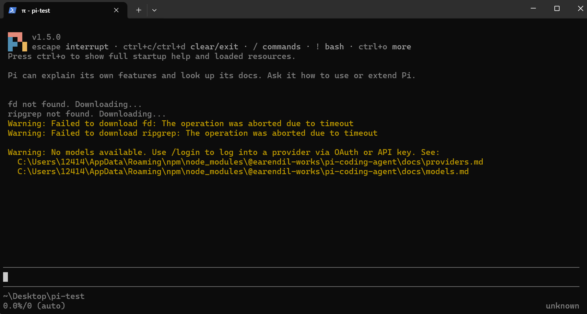
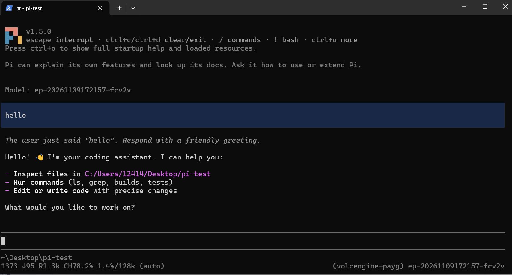
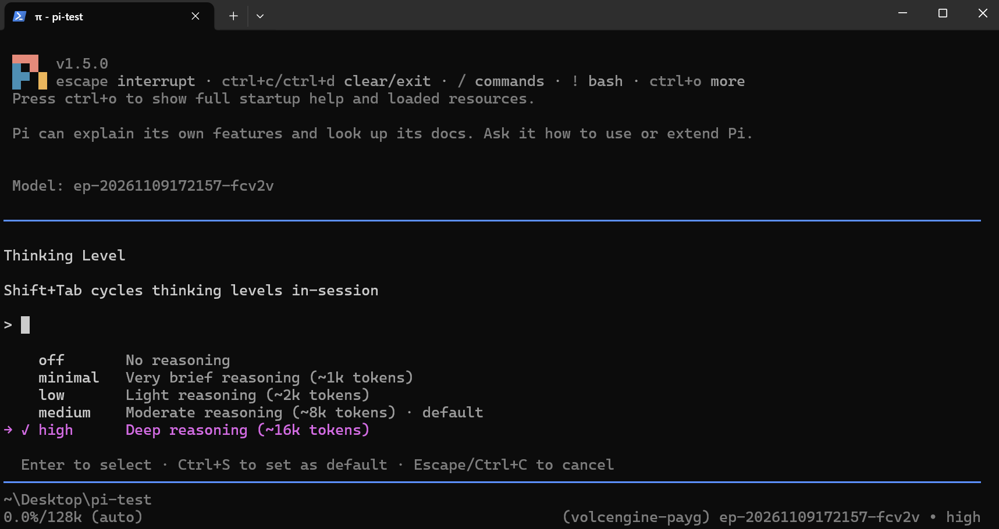
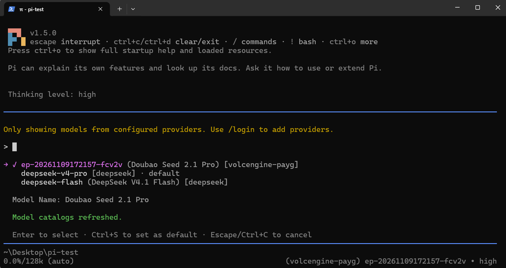
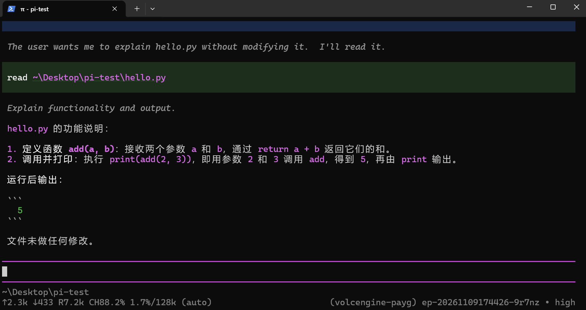
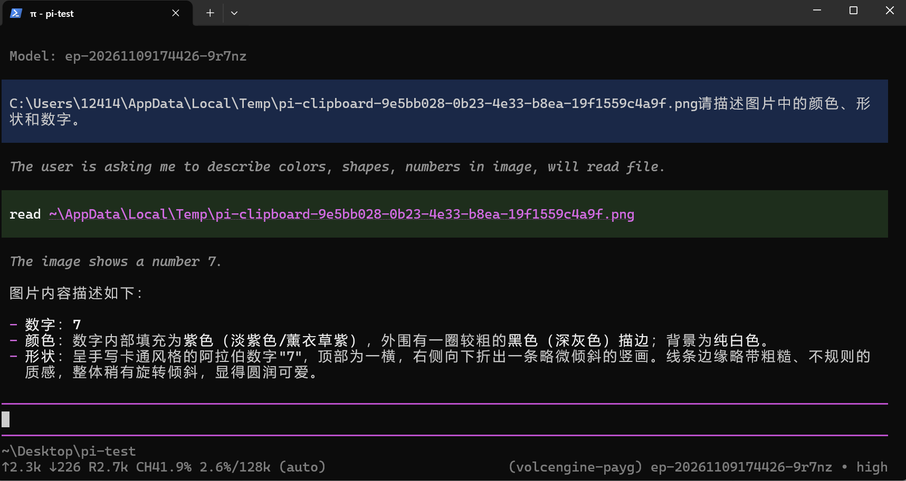
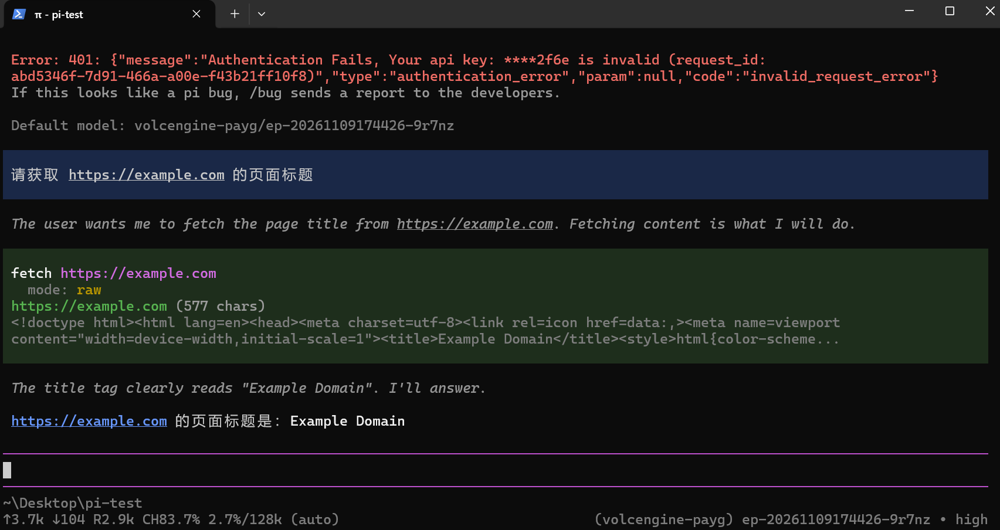
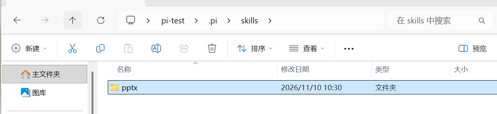
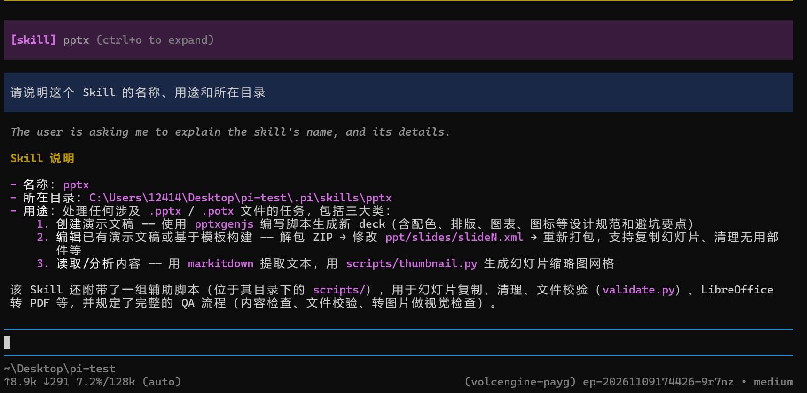

# 实践课1：Pi Agent 安装与使用

## 基本信息
- **姓名拼音**：zhanhangyi
- **GitHub 登录名**：Wurnn
- **完成时间**：2026年11月13日

---

## 任务一：本地安装并启动
**说明**：由于国内网络环境限制，官方 PowerShell 脚本无法拉取，故改用官方提供的 npm 安装方式：
`npm install -g --ignore-scripts @earendil-works/pi-coding-agent`。
安装成功后，在 `pi-test` 目录下启动 Pi，版本号为 v1.5.0。

**截图 S1**：

---

## 任务二：配置模型并完成会话
**说明**：配置了火山方舟（Volcengine）的模型。

**截图 S2**：

---

## 任务三：切换模型与思考级别
**说明**：
1. **思考级别切换**：使用 `/thinking` 命令，成功将思考级别从默认（off）调整至 `high`。因为当前接入的 Lite 模型对推理参数支持有限，已最大化开启深度思考能力。
2. **模型切换**：当前配置了基于火山引擎的接入点。对于复杂任务选择 high 思考级别，以获取更准确的代码生成建议；简单对话则维持普通速度。

**截图 S3-1（思考级别 high）**：

**截图 S3-2（底部状态）**：

---

## 任务四：引用代码与粘贴图片
### A. 使用 @ 引用代码文件
**说明**：让 Pi 自动生成了 `hello.py`，然后使用 `@` 选中该文件并提问，模型正确解释了代码逻辑并给出了输出结果。

**截图 S4**：

### B. 粘贴小图片并测试
**说明**：在画图中画了一个蓝色方块和数字7，复制到剪贴板后，使用 `Alt+V` 在 Pi 中粘贴并发送提示词，模型成功识别了颜色、形状和数字。

**原图参考**：

**截图 S5**：

---

## 任务五：安装并使用插件
**说明**：安装了网页抓取插件（或自带抓取能力的相关插件），并在重启后成功加载。发送指令让其抓取 `https://example.com` 的标题，工具成功执行并返回 `Example Domain`。

**截图 S6**：

---

## （可选）任务六：安装 PPTSkill
**说明**：已将 PPT Skill 完整安装到当前项目 `.pi/skills/pptx` 目录下（见图S7），重新启动 Pi 后成功发现该技能，并通过 `/skill:pptx` 指令调用。模型正确读取并总结了该 Skill 的名称、所在目录及三大核心用途。

**截图 S7 / S8**：

