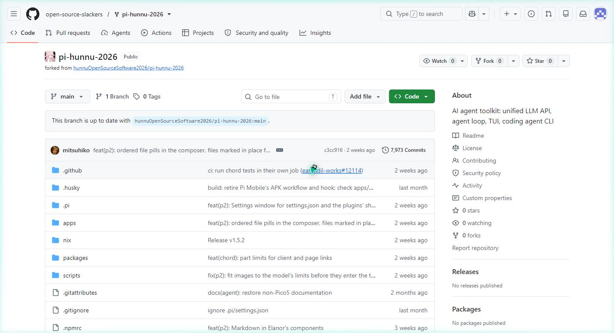
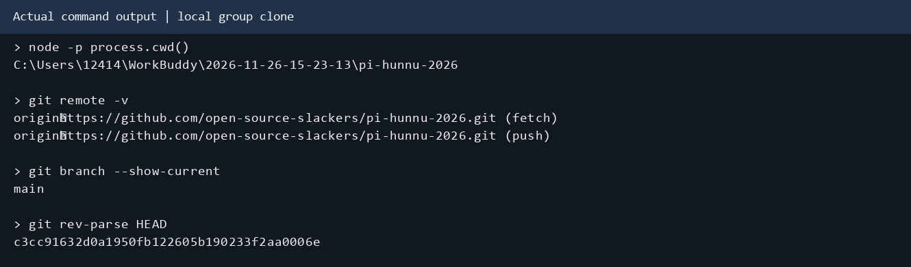
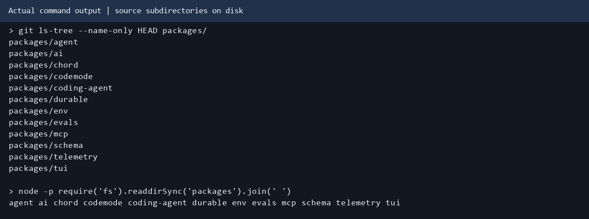
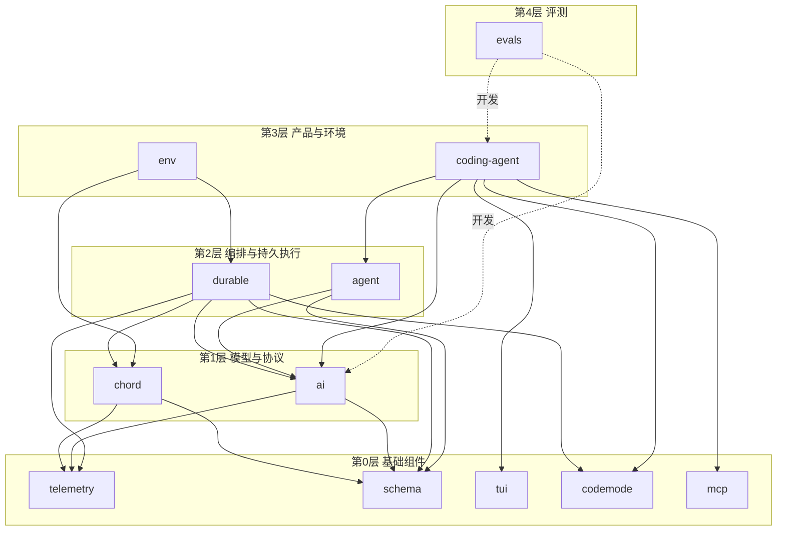

# 实践课2：组织建仓与源码分析

姓名拼音：`zhanhangyi`　GitHub：`Wurnn`

## 一、确认小组仓库与源码版本

组长已完成 fork。GitHub 仓库页显示所有者为 `open-source-slackers`，来源为课程组织的 `hunnuOpenSourceSoftware2026/pi-hunnu-2026`。公开页面只能证明仓库归属和 fork 来源，不能验证每名组员的写权限。本次未重新 fork。

- [小组组织仓库](https://github.com/open-source-slackers/pi-hunnu-2026)
- 实际 clone URL：`https://github.com/open-source-slackers/pi-hunnu-2026.git`
- 分支：`main`；[固定提交 c3cc91632d0a1950fb122605b190233f2aa0006e](https://github.com/open-source-slackers/pi-hunnu-2026/tree/c3cc91632d0a1950fb122605b190233f2aa0006e)
- 本地首次传输中断；在同一 clone 目录里以 `git fetch --depth=1 origin refs/heads/main:refs/remotes/origin/main` 获取主分支，再检出 `main`。检出后 `git status --short` 无输出。

```text
本地目录：C:/Users/12414/WorkBuddy/2026-11-26-15-23-13/pi-hunnu-2026
origin  https://github.com/open-source-slackers/pi-hunnu-2026.git (fetch)
origin  https://github.com/open-source-slackers/pi-hunnu-2026.git (push)
main
c3cc91632d0a1950fb122605b190233f2aa0006e
```

用 `git ls-tree --name-only HEAD packages/` 核验了 `agent`、`ai`、`chord`、`codemode`、`coding-agent`、`durable`、`env`、`evals`、`mcp`、`schema`、`telemetry`、`tui`。小组仓库的 owner 和 fork 来源已通过 Chrome 核对。下方第一张为仓库网页截图，后两张为本机命令输出记录。







## 二、模块对照

依据固定提交的[根 `package.json`（workspaces、build）](https://github.com/open-source-slackers/pi-hunnu-2026/blob/c3cc91632d0a1950fb122605b190233f2aa0006e/package.json#L5-L16)、各包的 `package.json`、`tsconfig.build.json` 和下表源码入口。重点阅读 `coding-agent`、`agent` 和 `ai` 的分工。下表“内部依赖”指 `dependencies` 中名称与本地工作区包匹配的直接声明，`evals` 的开发依赖单列。

| 模块 | 职责 | 本包 `build` 与产物 | 直接内部依赖 | 功能依据（`packages/` 下） |
|---|---|---|---|---|
| `telemetry` | 给组件提供记录指标、追踪和日志的统一接口 | `tsc` → `dist` 中的 JS 与声明 | 无 | `telemetry/README.md` |
| `schema` | 统一描述与校验数据形状，供工具参数和协议数据使用 | 同上 | 无 | `schema/README.md` |
| `chord` | 声明能力接口和合约，组织调用、运行环境与实现的绑定 | 同上 | `schema`、`telemetry` | `chord/README.md`、`chord/src/data/README.md` |
| `tui` | 管理终端输入、组件绘制和界面刷新 | 同上；原生辅助构建是单独脚本 | 无 | `tui/README.md` |
| `codemode` | 在受控运行时内执行代码并桥接宿主函数，不等同于模型 API | `tsc` → JS 与声明 | 无 | `codemode/README.md` |
| `mcp` | 封装 MCP 消息流和客户端调用，供上层接入外部工具 | 同上 | 无 | `mcp/README.md` |
| `ai` | 用统一模型与消息类型接入不同提供方，归一化流式返回 | 严格生成模型目录，检查模型数据，`tsc` 并复制模型附属数据到 `dist/providers/data` | `schema`、`telemetry` | `ai/package.json`、`ai/src/models.ts` |
| `durable` | 为长时间运行任务提供可持久化、可恢复的执行基础 | `tsc` → JS 与声明 | `chord`、`ai`、`codemode`、`schema`、`telemetry` | `durable/README.md` |
| `env` | 在持久执行基础上提供环境管理与接入 | 同上 | `chord`、`durable` | `env/README.md` |
| `agent` | 维护消息、驱动模型→工具→模型循环并发出执行事件 | 同上 | `ai`、`schema` | `agent/src/agent.ts`、`agent/src/agent-loop.ts` |
| `coding-agent` | 暴露 Pi CLI/TUI、持久会话及本地文件工具 | `build:unbundled` 编译、准备入口并复制资源；再打包生成 `dist/bundle/cli.js` | `agent`、`ai`、`codemode`、`mcp`、`tui` | `coding-agent/package.json`、`coding-agent/src/main.ts` |
| `evals`（额外） | 运行模型与 Agent 评测 | 没有 `build`，不在根构建链 | 开发：`ai`、`coding-agent` | `evals/README.md`、`evals/package.json` |

## 三、层级和直接依赖图

箭头统一指向被依赖方；实线为正常依赖，虚线为开发依赖。层级按工作区直接依赖的最大深度划分，不按文件夹顺序；0 层无内部直接依赖，后续每层只依赖更低层。该范围内没有需要画出的内部可选或 peer 依赖。下列 Mermaid 代码既是图源，在支持 Mermaid 的 GitHub Markdown 上也是可读图。



## 四、回答三个问题

1. **两级 `npm run build` 各读什么？** 在根目录，npm 从根 `package.json` 的 `scripts.build` 读取一串 `cd` 和 `npm run build`。进入子包后，同一命令读的是子包自己的 `package.json`。多数子包再通过 `tsc -p tsconfig.build.json` 决定编译范围和 `dist` 输出，公共选项继承根 `tsconfig.base.json`。AI 包额外生成模型目录和复制数据，CLI 额外复制界面资源并打包。
2. **构建顺序和依赖有什么关系？** 脚本顺序为 `telemetry → schema → chord → tui → codemode → mcp → ai → durable → env → agent → coding-agent`。箭头在这一行表示执行先后，不是依赖箭头。下游编译可能读取上游包导出的 JS/类型，所以上游要先产出。`&&` 只表示上一命令成功才继续；例如 `tui` 和 `codemode` 在构建中相邻，但它们的依赖字段没有互相引用。
3. **三个模块怎么分工？** `coding-agent → agent → ai`：CLI 收用户输入、组织工具和会话；`agent` 决定把哪些消息交给模型、执行哪次工具调用、何时再请求；`ai` 依据所选提供方适配协议，将远端模型流转成共同事件。模型能建议调用 `read`，实际读取由客户端工具完成，不是远端服务读取本地磁盘。

## 提交信息

Issue 标题：`实践课2：组织建仓与源码分析 [zhanhangyi]`。正文应贴出上述实际 clone URL、小组仓库 URL 和推送后的 [个人报告 URL](https://github.com/Wurnn/Pi-Agent/blob/main/practice2/practice-02.md)。
