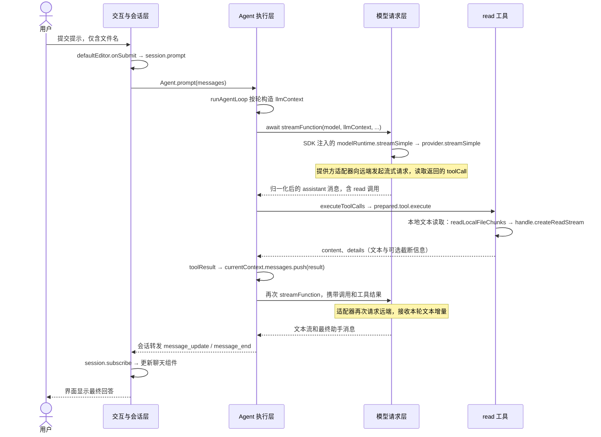
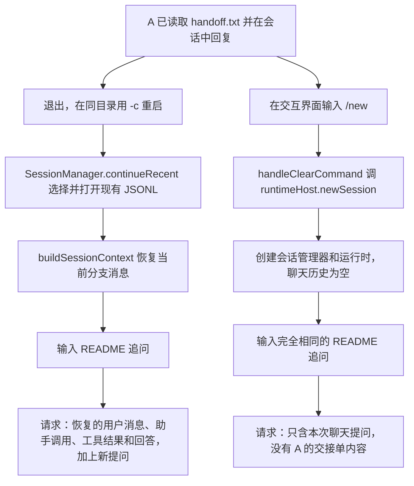

# 实践课5：Pi Agent 工具调用与会话恢复

姓名拼音：`zhanhangyi`　GitHub：`Wurnn`

源码基线：[小组仓库 `c3cc91632d0a1950fb122605b190233f2aa0006e`](https://github.com/open-source-slackers/pi-hunnu-2026/tree/c3cc91632d0a1950fb122605b190233f2aa0006e)。两张图根据该提交的源码绘制，并用下面的交互记录核对了实际工具调用与会话行为。[实践 3](../practice3/practice-03.md) 的标准根构建未完成，但后续分段构建已生成并验证本课要用的本地 `dist/cli.js`（`1.5.2`）。

## A. 一次用户输入，两次模型请求

将 [handoff.txt](handoff.txt) 放在小组源码根目录。自定标识为 `slacker-8f26c3`，只存在于交接单内容中，不在首次提示词里。启动 `node .\packages\coding-agent\dist\cli.js` 后，在新会话输入：

> 请用 read 工具读取当前目录的 handoff.txt，原样告诉我待办和启动命令。

### 图 1：一次文本文件读取的代码级时序

源码定位（下列链接固定在实验版本）：

- [interactive-mode.ts:3325、3526、3649–3685](https://github.com/open-source-slackers/pi-hunnu-2026/blob/c3cc91632d0a1950fb122605b190233f2aa0006e/packages/coding-agent/src/modes/interactive/interactive-mode.ts#L3325)：提交回调接收文本，普通输入转给会话；订阅消息更新并更新聊天组件。[agent-session.ts:1982](https://github.com/open-source-slackers/pi-hunnu-2026/blob/c3cc91632d0a1950fb122605b190233f2aa0006e/packages/coding-agent/src/core/agent-session.ts#L1982) 将准备好的消息传给 Agent。
- [agent.ts:382](https://github.com/open-source-slackers/pi-hunnu-2026/blob/c3cc91632d0a1950fb122605b190233f2aa0006e/packages/agent/src/agent.ts#L382) 是 `Agent.prompt()`，同文件[第 441–454 行](https://github.com/open-source-slackers/pi-hunnu-2026/blob/c3cc91632d0a1950fb122605b190233f2aa0006e/packages/agent/src/agent.ts#L441-L454) 进入 `runAgentLoop()`；[SDK 第 416–423 行](https://github.com/open-source-slackers/pi-hunnu-2026/blob/c3cc91632d0a1950fb122605b190233f2aa0006e/packages/coding-agent/src/core/sdk.ts#L416-L423) 注入 `streamFn`，转到 `modelRuntime.streamSimple(...)`。[agent-loop.ts:404–412](https://github.com/open-source-slackers/pi-hunnu-2026/blob/c3cc91632d0a1950fb122605b190233f2aa0006e/packages/agent/src/agent-loop.ts#L404-L412) 负责消息转换和调用流函数；同文件第 835 行执行已准备好的工具，第 284 行写入工具结果。
- [ai/models.ts:958–965](https://github.com/open-source-slackers/pi-hunnu-2026/blob/c3cc91632d0a1950fb122605b190233f2aa0006e/packages/ai/src/models.ts#L958-L965) 选择提供方的流函数。例如 OpenAI Chat Completions 兼容路径经 [openai-completions.ts:385](https://github.com/open-source-slackers/pi-hunnu-2026/blob/c3cc91632d0a1950fb122605b190233f2aa0006e/packages/ai/src/api/openai-completions.ts#L385) 请求远端，不代表所有提供方都用该接口。
- [read.ts:68–89](https://github.com/open-source-slackers/pi-hunnu-2026/blob/c3cc91632d0a1950fb122605b190233f2aa0006e/packages/coding-agent/src/core/tools/read.ts#L68-L89) 的本地文本默认读取实现用文件句柄的 `createReadStream`。[read.ts:296–308](https://github.com/open-source-slackers/pi-hunnu-2026/blob/c3cc91632d0a1950fb122605b190233f2aa0006e/packages/coding-agent/src/core/tools/read.ts#L296-L308) 根据参数判断是否走流式读取；对普通短文本的默认整段请求走流式，非可流式范围或不提供流操作的后端才走缓冲区读取，图片另走二进制分支。

## B. 恢复与新建的对照

完成 A 后退出，保持同一目录、同一模型，用 `node .\packages\coding-agent\dist\cli.js -c` 重启；确认展示 A 的聊天记录，再问下列问题。接着输入 `/new`，在新会话中原样再问一次：

> 接着上次的待办，给 README 起草一条启动说明，写出交接单里的完整启动命令。只用这次会话已有的信息。不要调用工具。如果缺少命令，请直接说明。

### 图 2：相同提问，不同的聊天历史

`-c` 在 CLI 解析后进入 [main.ts:480](https://github.com/open-source-slackers/pi-hunnu-2026/blob/c3cc91632d0a1950fb122605b190233f2aa0006e/packages/coding-agent/src/main.ts#L480)；[SessionManager.continueRecent](https://github.com/open-source-slackers/pi-hunnu-2026/blob/c3cc91632d0a1950fb122605b190233f2aa0006e/packages/coding-agent/src/core/session-manager.ts#L1806-L1819) 选择最近会话，没找到才创建新会话。[SDK](https://github.com/open-source-slackers/pi-hunnu-2026/blob/c3cc91632d0a1950fb122605b190233f2aa0006e/packages/coding-agent/src/core/sdk.ts#L395-L415) 以 `existingSession.messages` 初始化 Agent。`/new` 由 [interactive-mode.ts:3429](https://github.com/open-source-slackers/pi-hunnu-2026/blob/c3cc91632d0a1950fb122605b190233f2aa0006e/packages/coding-agent/src/modes/interactive/interactive-mode.ts#L3429) 在本地拦截，经 `handleClearCommand` 到 [runtimeHost.newSession](https://github.com/open-source-slackers/pi-hunnu-2026/blob/c3cc91632d0a1950fb122605b190233f2aa0006e/packages/coding-agent/src/core/agent-session-runtime.ts#L226-L259)，不把 `/new` 发给模型。新会话没有 A 的聊天历史，不代表没有系统提示或工具定义。恢复的是本地 JSONL 中的消息，不是模型自己记住了上次对话。

## C. 运行证据与修改位置

补充的本地检查：筛选 `read` 和最近会话选择相关的上游测试，24 项通过；会话运行时的新建/恢复事件专项测试，1 项通过。另跑的 SDK 默认配置测试为 2 通过、2 失败，失败项是 Windows 路径字符串断言；未改动测试。这些检查不等于真实模型对话，也不能替代下面的证据。

| 会话 | 实测结果 | 终端证据 |
|---|---|---|
| A：读取交接单 | 一次 `read`，工具结果写入会话；Pi 答复“待办：补充 README 的启动说明”，并给出 `npm run demo -- --profile slacker-8f26c3`。 | [读取与答复](images/A-read.png) |
| B1：`-c` 恢复后追问 | 界面重现 A 的聊天记录；追问后没有新的工具调用。Pi 答复“运行演示：”，并给出完整命令 `npm run demo -- --profile slacker-8f26c3`。 | [恢复记录](images/B1-restored.png) · [追问答复](images/B1-answer.png) |
| B2：`/new` 同句追问 | 界面提示 `New session started`，另写一个 JSONL，首条用户消息就是同一句追问。没有工具调用；Pi 答道：“缺少交接单中的完整启动命令……因此无法可靠起草 README 启动说明。”未猜出或给出该命令。 | [新会话答复](images/B2-new.png) |

各阶段使用同一个本地构建 CLI、工作目录和返回模型 `doubao-seed-2-1-pro-260915`，会话文件由 `--session-dir` 隔离。图中 A 的 `read` 调用、工具结果和最终文本均在保存的会话中出现；B1 在原 JSONL 继续写入，B2 创建独立 JSONL。两次追问都允许 `read`，但没有实际调用工具。由此可见，恢复会话可使用已持久化的聊天历史；新会话不会自动带入它。本次只输出 README 启动说明草稿，并未执行交接单中的命令或修改 README。图片由实际交互进程的 Windows 伪终端画面渲染。

如果要改 `/new` 的按键或反馈文案，入口在交互层；要改历史选择、恢复与分支重建，应看 `main.ts` 和 `session-manager.ts`；要改文件截断策略，则在 `read.ts`，不应改模型请求层。

Issue 标题：`实践课5：Pi Agent工具调用与会话恢复 [zhanhangyi]`；正文附[个人报告 URL](https://github.com/Wurnn/Pi-Agent/blob/main/practice5/practive-05.md)。文件名 `practive-05.md` 按课程说明原样保留。
